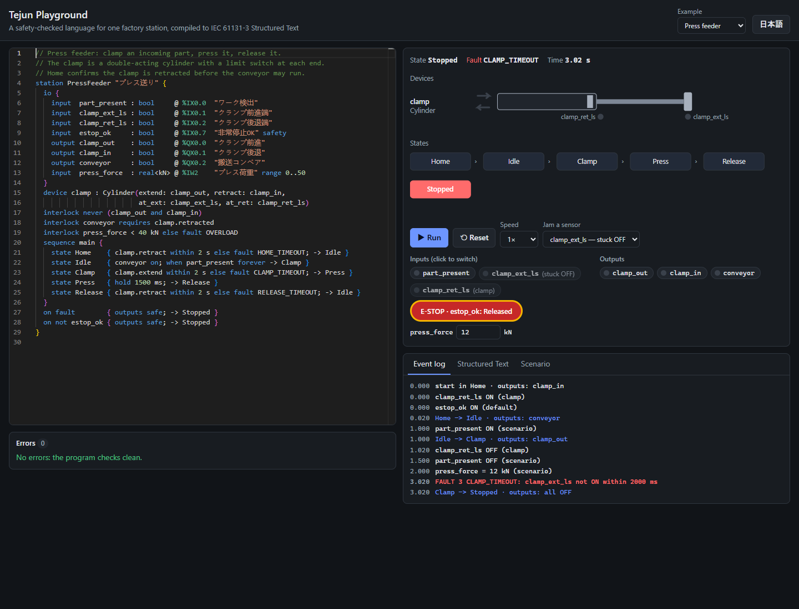
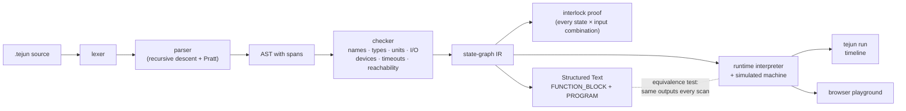

# Tejun (手順)

**A small language for programming one factory machine station, whose compiler
catches the bugs that break machines before the code runs.** You describe the
station's sensors, cylinders and outputs, the interlocks between them, and the
sequence of steps. Tejun proves the interlocks can never be violated, rejects
waits with no timeout, dead-end steps, I/O and unit mistakes, and makes double
coils impossible to write. Then it generates IEC 61131-3 Structured Text that
compiles with matiec, OpenPLC's compiler ([logs](docs/plc-verification.md)), and
runs the same program in a simulator that is tested to behave exactly like the
generated PLC code. Every message comes in English and
Japanese.

<!-- Demo GIF goes here: docs/demo.gif (edit, see an error, run, jam a sensor). -->


**Playground:** the browser playground (editor with live errors, simulator, generated
Structured Text) is published to GitHub Pages by the *Deploy playground* workflow;
the link appears here after the first deploy. To run it locally: `npm run playground`.

## Quickstart

Needs Node.js 22 or newer.

```sh
npm install
npm run build
npx tejun run examples/press_feeder.tejun --jam clamp_ext_ls
```

The last command simulates the press feeder with its clamp's extended sensor stuck
OFF. The clamp moves, the sensor never confirms, and after 2 s the machine raises
`CLAMP_TIMEOUT` and switches every output off:

```text
  1.000  Idle -> Clamp                      outputs: clamp_out
  3.020  FAULT 3 CLAMP_TIMEOUT: clamp_ext_ls not ON within 2000 ms
  3.020  Clamp -> Stopped                   outputs: all OFF
end at 3.020 s: Stopped, fault CLAMP_TIMEOUT
```

More commands:

```sh
npx tejun check examples/press_feeder.tejun        # check: prints OK or the errors
npx tejun build examples/press_feeder.tejun        # writes out/press_feeder.st
npx tejun run examples/pick_place.tejun            # simulate with examples/pick_place.scenario
```

## What a program looks like

```tejun
// Press feeder: clamp an incoming part, press it, release it.
station PressFeeder "プレス送り" {
  io {
    input  part_present : bool     @ %IX0.0  "ワーク検出"
    input  clamp_ext_ls : bool     @ %IX0.1  "クランプ前進端"
    input  clamp_ret_ls : bool     @ %IX0.2  "クランプ後退端"
    input  estop_ok     : bool     @ %IX0.7  "非常停止OK" safety
    output clamp_out    : bool     @ %QX0.0  "クランプ前進"
    output clamp_in     : bool     @ %QX0.1  "クランプ後退"
    output conveyor     : bool     @ %QX0.2  "搬送コンベア"
    input  press_force  : real<kN> @ %IW2    "プレス荷重" range 0..50
  }
  device clamp : Cylinder(extend: clamp_out, retract: clamp_in,
                          at_ext: clamp_ext_ls, at_ret: clamp_ret_ls)
  interlock never (clamp_out and clamp_in)
  interlock conveyor requires clamp.retracted
  interlock press_force < 40 kN else fault OVERLOAD
  sequence main {
    state Home    { clamp.retract within 2 s else fault HOME_TIMEOUT; -> Idle }
    state Idle    { conveyor on; when part_present forever -> Clamp }
    state Clamp   { clamp.extend within 2 s else fault CLAMP_TIMEOUT; -> Press }
    state Press   { hold 1500 ms; -> Release }
    state Release { clamp.retract within 2 s else fault RELEASE_TIMEOUT; -> Idle }
  }
  on fault        { outputs safe; -> Stopped }
  on not estop_ok { outputs safe; -> Stopped }
}
```

Remove the `Home` state and the interlock proof explains the startup bug that
remains: the conveyor would run before anything confirmed the clamp is retracted.

```text
error[T0203]: interlock violated: `conveyor` can be ON while `clamp.retracted` is false
  --> examples/press_feeder.tejun:21:21
   |
21 |     state Idle    { conveyor on; when part_present forever -> Clamp }
   |                     ^^^^^^^^^^^ `conveyor` is ON here in `Idle`
   |
   = path: Idle (at startup)
   = interlock: `interlock conveyor requires clamp.retracted` (line 18)
   = help: the position of `clamp` is unknown at startup; confirm it first, e.g. `state Home { clamp.retract within 2 s else fault HOME_TIMEOUT; -> Idle }`
   = 日本語: インターロック違反: `clamp.retracted` が偽のときに `conveyor` がONになる可能性があります
```

## How it works



- The code generator and the interpreter read the same IR, and
  `tests/equivalence.test.ts` runs the *generated ST text* next to the simulator
  scan by scan, for every example, every jammed sensor, and random inputs.
- The interlock proof is a breadth-first search over (state, step done, device
  positions) with every combination of inputs, so the path it reports is the shortest.
- No runtime dependencies in the compiler or runtime; the playground runs everything
  in the browser.

| Package | |
|---|---|
| `packages/compiler` | lexer, parser, checker, IR, interlock proof, ST generator |
| `packages/runtime` | scan-cycle interpreter, simulated machine, scenarios, timeline |
| `packages/cli` | `tejun check`, `build`, `run` |
| `packages/playground` | Vite + React + Monaco web playground |

## Docs

- [Language reference](docs/language-reference.md) — every construct, with examples
- [Diagnostic codes](docs/checks.md) — every error, with real output and the fix
- [Tejun for ladder engineers](docs/for-ladder-engineers.md) — ラダー技術者のための Tejun
- [PLC verification](docs/plc-verification.md) — the generated ST compiled with matiec, with logs
- [Grammar](docs/grammar.ebnf)

## Limitations

- One station per program; no multi-station lines, PackML states or robot motion.
- The only device kind is a double-acting `Cylinder`; real-valued outputs are not driven.
- The interlock proof handles up to 10 free inputs per station.
- Generated Structured Text is compiled with matiec, OpenPLC's compiler, on every push
  ([how, with logs](docs/plc-verification.md)). It has not been run inside OpenPLC Runtime,
  and CODESYS, Sysmac Studio and GX Works3 are untested; the same doc lists what differs there.
- No ladder output and no connection to real hardware I/O.
- Tejun is a development aid. It is not a certified safety system and does not replace
  a safety PLC or a hard-wired emergency stop.

## Development

```sh
npm test                    # all tests (Vitest)
npm run typecheck           # TypeScript, including tests and the playground
npm run playground          # playground dev server at http://localhost:5173
npm run build:playground    # static playground in packages/playground/dist
```

Built for the Syntax Summit hackathon.
